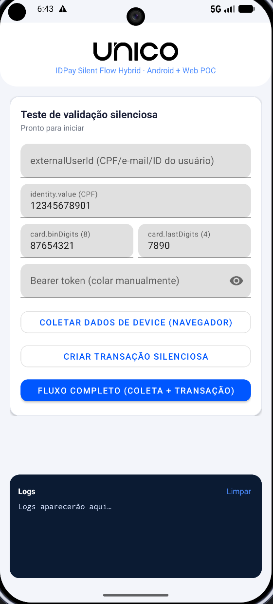

<p align="center">
  <a href="https://unico.io">
    
  </a>
</p>

<h1 align="center">IDPay Silent Flow Hybrid — Android + Web POC</h1>

<div align="center">

### Silent transaction validation POC — a native app runs the device data collection on a web page, preloaded in a hidden WebView


</div>

---

## 🎯 What this POC does

Scenario: a **native** app runs the device data collection on a web page (`collect-page/`), split in two steps:

1. **Prepare, when the screen opens.** The app loads the page in a **hidden WebView** (`INVISIBLE`, full-screen size). The page runs `initializeSDK(unicoConfig)` right away — the slow part (SDK load, authentication, device fingerprint) happens while the user is still reading or typing.
2. **Send, at the tap.** The app shows its own loading and calls `collect(externalUserId)` on the page (`evaluateJavascript`). The page runs `startSilentValidation(externalUserId)` — **the camera is never opened** — and reports back through a JavaScript bridge (`CollectBridge`) once the collection has been **sent**. The same bridge tells the app when the SDK is ready, or that the prepare failed so the page is reloaded. A fresh page is then preloaded for the next validation (one SDK session serves one validation).
3. The app creates an IDPay transaction (`POST /api/public/v1/credit/transaction`) with the **same `externalUserId`** in `additionalInfo.externalUserID`. In a real integration this request is made by the **client's backend** (server-to-server) — the POC shortcuts that hop and calls the API directly.
4. Result:
   - `status: approved` → **silent approval**, with no additional friction (green screen);
   - otherwise → the app automatically opens the challenge `link` (Custom Tabs) and receives the return via deep link.

With `USE_WEBVIEW = false` the app opens the page in **Custom Tabs** at the tap instead, passing the `externalUserId` in the **URL fragment** (stripped before the SDK loads); prepare and send then run back to back, and the page returns via deep link (`silentflowhybrid://done`).

The **"Fluxo completo"** (full flow) button runs everything in sequence. The collect page is **static** — no npm, no build step: the Web SDK bundle is imported from the URL in `config.js → SDK_BUNDLE_URL` (by default the npm CDN, pinned to a specific version).

<p align="center">
  
</p>

> ⚠️ **Page host**: the Web SDK validates the page's **real** host against the hosts registered for the SDK Key, and requires a browser secure context — over plain HTTP, only `localhost` qualifies; any other host requires **HTTPS**. That is why local testing uses `localhost` + `adb reverse` (step by step below).
>
> ⚠️ The `externalUserId` used in the collection and the `additionalInfo.externalUserID` sent in the transaction must be **identical, character by character**.
>
> ⚠️ The collection is **valid for at most 5 minutes**: the transaction must be created within that window. The first transactions of a given `externalUserId` return a challenge — silent approval depends on prior history on the **same device**.

---

## 💻 Compatibility

- **Android:** 7.0 (API level 24) or higher
- **Kotlin:** 2.2
- Web SDK `unico-webframe` **3.28+** (provides `initializeSDK`/`startSilentValidation`; the page imports it pinned from the npm CDN)
- Any static file server for the page (the included `serve.py` is recommended)

---

## ⚙️ Setup before running

This repository **contains no real credentials**. Replace the placeholders:

| Where | What to replace | Value |
| --- | --- | --- |
| `collect-page/config.js` | `SDK_KEY` | Your **Web SDK Key** (by client mode), registered for the page host and with `silentInfo` sending enabled |
| `app/.../PocConfig.kt` | `COMPANY_ID` | Your IDPay company UUID |
| `app/.../PocConfig.kt` | `COLLECT_PAGE_URL` | Where the page is served (default `http://localhost:3000`) |
| `app/.../PocConfig.kt` | `USE_WEBVIEW` | Container for the collect page: hidden WebView preloaded when the screen opens (`true`, default) or Custom Tabs opened at the tap (`false`) |

The **access token (Bearer)** is **not hardcoded** — paste it into the "Bearer token" field on the screen before running, since it usually has a short lifetime.

To generate Unico credentials, see the [official documentation](https://developer.unico.io/).

---

## ⏱️ Timing

Measured on a real device (UAT, Wi-Fi), WebView mode:

| Step | When | Time |
| --- | --- | --- |
| Prepare (`initializeSDK`) | when the screen opens, hidden | ~2.5s |
| Send (`startSilentValidation`) | at the tap — **the only loading the user sees** | ~0.9s |

To hide the whole prepare, load the page as soon as the screen opens — at
least ~3s before the tap. A tap during the prepare just waits for what is left
of it. The preloaded page
survives the app going to the background or the screen locking.

The app creates the transaction right after the send — there is no extra
margin. The collection takes ~1s more to be processed on Unico's side, so a
transaction created immediately may occasionally not find it and follow the
standard flow with a challenge.

If the collection fails, the flow degrades gracefully: the transaction is created normally and follows the
standard visual flow — the silent approval is simply not attempted for that
transaction.

---

## ▶️ Running the test (local)

**1. Serve the collect page** (from the repository root):

```bash
cd collect-page
python3 serve.py   # static server on port 3000 (page files uncached)
```

**2. adb tunnel** (with the emulator/device connected) — makes the device's `localhost:3000` point to your machine:

```bash
adb reverse tcp:3000 tcp:3000
```

> Run this command again if the device/emulator restarts. It is needed because
> the local SDK Key is registered for `localhost` — the only host the browser
> treats as secure without HTTPS.

**3. Install and open the app** (Android Studio ▶ or `./gradlew installDebug`).

**4. Test**: fill in the fields (or keep the examples), paste the Bearer token, wait a few seconds on the screen (the SDK prepares in the background) and tap **"Fluxo completo"** (full flow) — loading → transaction → **approved** (green screen) or challenge. The log shows each collection's time from the tap.

Smoke test of the page without the app: open `http://localhost:3000/#externalUserId=test` in your desktop browser and check the debug panel at the bottom.

---

## 📁 Structure

```
app/            # Native Android app (opens the page and creates the transaction)
collect-page/   # Static collect page (Web SDK in silent mode)
  index.html    # Loading + return to the app
  collect.js    # initializeSDK on load + collect() → startSilentValidation, result via bridge or deep link
  config.js     # SDK Key, environment, use case, deep link
  serve.py      # local static server (long cache only for a self-hosted SDK bundle)
```

> ⚠️ For simplicity, this POC imports the Web SDK bundle from the npm CDN by
> default. In a real integration, **download the bundle and serve it from your
> own infrastructure** (versioned, with a long-lived cache) and point
> `SDK_BUNDLE_URL` to it — you control availability, integrity and rollout,
> and repeat visits skip the download. `index.html` also opens the connection
> to the SDK backend early (`preconnect`); adjust its host per environment.

> The silent flow does not need the SDK's additional resources (the FaceTec
> files and models from step 4 of the installation guide) — those are only
> required when the camera is opened for a capture journey.

In production, the `collect-page/` is hosted on an **HTTPS** domain registered for the SDK Key (owned by the client or by Unico) — the app just changes `COLLECT_PAGE_URL`, and the `adb reverse` step goes away. Serve the SDK bundle with a long-lived cache (versioned filename + `immutable`), so only the user's first validation pays the download.
